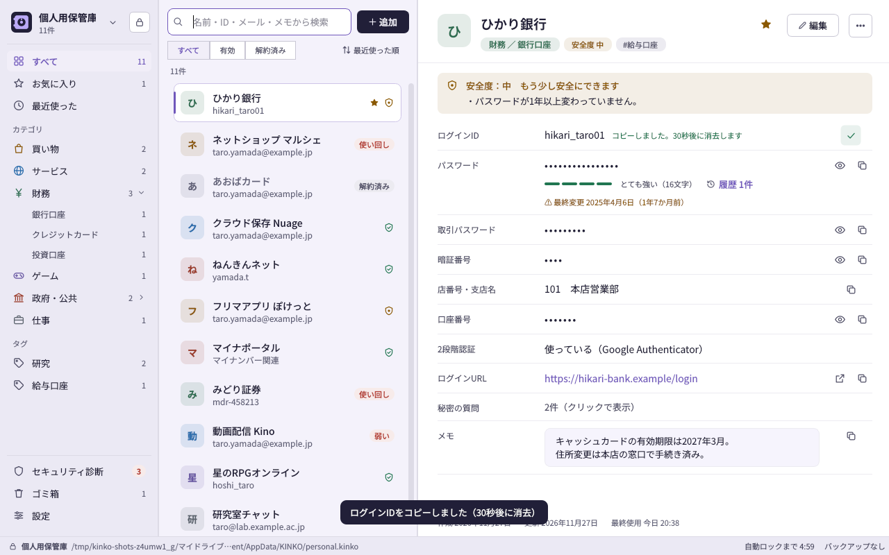
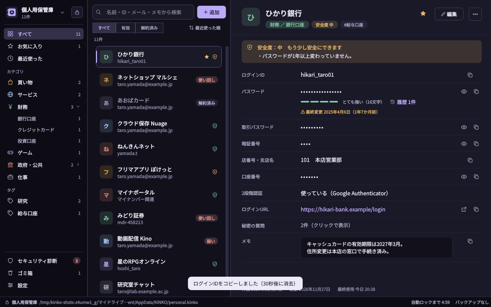
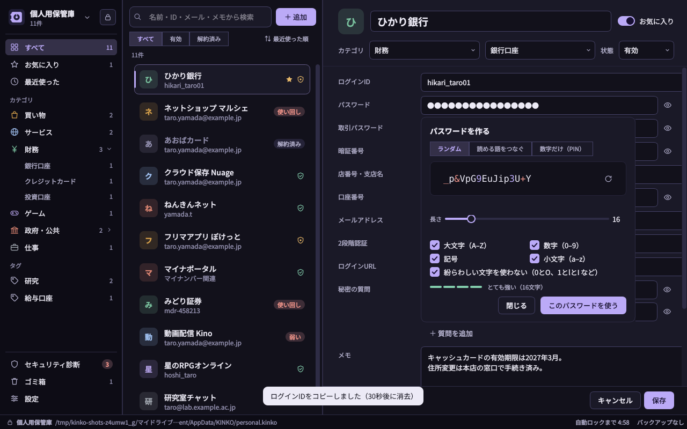
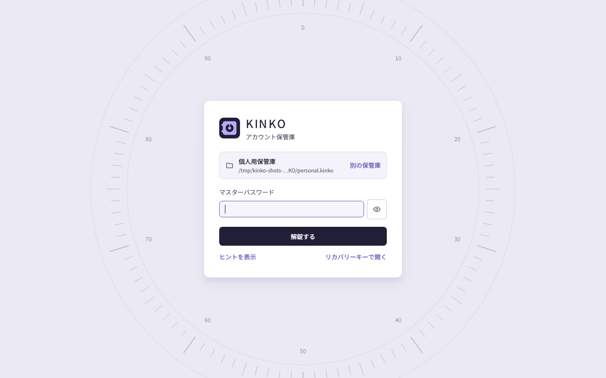

# KINKO（金庫）

ID・パスワード・暗証番号・取引パスワード・基礎年金番号などを、1つの暗号化された保管庫にまとめて管理するデスクトップアプリです。
個人用ツール「Account Manager（Ver2.0.8）」の後継です。いまの版は 1.0.1 です（[変更履歴](CHANGELOG.md)）。



| ダーク | 編集とパスワード生成（ダーク） | ロック画面 |
| --- | --- | --- |
|  |  |  |

画面の中のデータはすべて架空です。

## 必要なもの

- Python 3.10 以上
- PyQt6 6.5 以上、cryptography、argon2-cffi（`requirements.txt`）

```bash
python3 -m pip install -r requirements.txt
```

PyCharm で開く場合は、プロジェクトのインタープリターに同じものを入れてください。

## 起動

- Mac：`KINKO.command` をダブルクリック、またはターミナルで `python3 main.py`
- Windows：`KINKO.bat` をダブルクリック、または `python main.py`

Windows のタスクバーには KINKO のアイコンが出ます（1.0.1 から）。デスクトップにショートカットを作るときは、
アイコンに `assets/icon/kinko.ico` を選べます。

## はじめて使うとき（Account Manager からの移行）

1. 起動して「Account Manager（Ver2）から移行」を選びます。
2. 移行元の `accounts.db` を選びます（App Development 内の Account Manager フォルダから自動で探します）。
3. Account Manager のマスターパスワードを入力して「確認」を押します。
4. 新しい保管庫の名前と保存先を決めます（既定は Google ドライブの `App Development/AppData/KINKO`）。
5. 新しいマスターパスワードを決めます（Account Manager と同じでも構いません）。
6. 移行結果（件数、解約済み、旧パスワードの履歴）を確認します。
7. リカバリーキーを控えます。「緊急キット（PDF）を保存」で印刷用のPDFを作り、印刷したらPDFは削除してください。

移行元の `accounts.db` は読み取り専用で開くので、一切変更されません。

## ファイルの置き場所

| もの | 場所 |
| --- | --- |
| 保管庫 | `マイドライブ/App Development/AppData/KINKO/personal.kinko`（既定） |
| 自動バックアップ | 保管庫と同じフォルダの `backups/`（設定で変更可） |
| 設定 | Mac：`~/Library/Application Support/KINKO/settings.json`、Windows：`%APPDATA%\KINKO\settings.json` |
| ログ | 設定と同じフォルダの `logs/kinko.log`（パスワードなどは書きません） |
| 色の上書き（任意） | 設定と同じフォルダの `theme.json` |

保管庫とバックアップは中身がすべて暗号化されているので、Google ドライブに置いて構いません。
リカバリーキー（緊急キット）は、保管庫と同じ場所に置かないでください。

## できること

- 3ペインの画面：左にカテゴリ・タグ・お気に入り・最近使った・セキュリティ診断・ゴミ箱、中央に一覧、右に詳細と編集
- どこでも検索：名前・ID・メール・URL・メモ・タグを横断。全角半角、大文字小文字、ひらがなカタカナを区別しません
- コピーしたパスワードやIDは30秒後に自動消去（その間に別の内容をコピーしていれば消しません）
- パスワード生成（ランダム／読める語をつなぐ／数字だけのPIN）と強度表示
- パスワード・暗証番号などの変更履歴（全世代、日付つき）
- アカウントごとの安全度（高・中・低）。一覧の盾の印と詳細の上部に出て、「セキュリティ診断」で低い順に一覧できます（下の「安全度の決め方」）
- 2段階認証は「使っている／使えるが、まだ使っていない／このサービスにはない／未確認」で記録
- 一覧の上の「＋追加」で新しいアカウント、詳細の「…」の「同じサービスの別アカウントを追加」で、同じサービスの2つ目のアカウント（名前・分類・URL・タグだけを引き継ぎ、ID やパスワードは空）
- 解約済みの記録、お気に入り、タグ、ゴミ箱（30日で自動削除、元に戻せる）
- 自動ロック（無操作5分・最小化・画面ロック時）、手動ロック
- マスターパスワードの変更、リカバリーキーでの解錠と再発行
- 変更のたびの自動バックアップ（直近20件＋日ごと30日分）と、バックアップからの復元
- Google ドライブ経由で別のPCが保管庫を更新した場合は、上書きせずに読み込み直します

## カスタマイズ

設定（⌘, / Ctrl+,）で変えたものは、すぐに保存・反映されます。

| 画面 | 変えられること |
| --- | --- |
| 一般 | 表示言語（日本語／English）、起動時に前回の保管庫を開くか、新しい保管庫の保存先、ゴミ箱の保持日数 |
| 表示 | テーマ（ライト／ダーク／システム）、表示密度、文字の大きさ、フォント、一覧の2行目、並び順、サイドバーに出す項目 |
| セキュリティ | 自動ロックの時間、最小化・アプリ切替・画面ロック時のロック、クリップボードの消去秒数 |
| パスワード生成 | 既定の種類、長さ、使う文字と記号、紛らわしい文字の除外、語の数と区切り、PINの桁数 |
| カテゴリと型 | カテゴリの追加・名前・アイコン・色・並び順・削除、詳細カテゴリ、解約時の表示、型（どの項目を表示するか）の追加・項目の追加・並べ替え・名前変更 |
| バックアップ | 保存先、残す数と日数、今すぐバックアップ、復元 |
| ショートカット | すべての操作のキー |

アカウントごとに自由な項目（会員番号、有効期限など）を追加することもできます。
カテゴリと型は保管庫の中に保存されるので、別のPCで開いても同じになります。

表示する文言は、設定フォルダに `i18n/ja.json`（英語は `en.json`）を置くと上書きできます。

```json
{"lock.unlock": "開ける"}
```

色を変えたいときは、設定フォルダに `theme.json` を置きます。`kinko/ui/palette.json` と同じ形で、変えたい役割だけを書けば十分です
（役割の名前は colour-themes と同じ。ほかの色やおかしな値は無視されます）。次に起動したとき、またはテーマを切り替えたときに反映されます。

```json
{"dark": {"accent": "#6FD8CC"}, "light": {"accent": "#007672"}}
```

## 安全度の決め方

自分で直せることだけで決めます。サービスに2段階認証がないことは、安全度を下げません。

| 安全度 | 一覧の印 | どんなとき |
| --- | --- | --- |
| 高 | 緑の盾（✓） | 強いパスワードで、ほかのアカウントと別、1年以内に変更。2段階認証は使っている、またはサービスにない |
| 中 | 金茶の盾（・） | パスワードの強さがふつう、1年以上変えていない、2段階認証が使えるのに使っていない。金融のアカウントで、2段階認証があるか未確認 |
| 低 | 赤い「使い回し」「弱い」 | パスワードが弱い、またはほかのアカウントと同じ |

- 安全度が付くのは、パスワードのある有効なアカウントだけです（解約済みや、年金番号だけの記録などには付きません）。
- 金融のアカウントだけ「未確認」を中にしているのは、銀行や証券会社のほとんどが2段階認証を用意しているためです。ないときは「このサービスにはない」を選べば高になります。
- サイドバーの「セキュリティ診断」の赤い数字は「低」の件数です（なければ「中」の件数を灰色で）。

## 配色

[colour-themes](https://github.com/zhuyushuyo/colour-themes) の「藤 Fuji」をもとにした KINKO 版で、ダークとライトが1つずつあります（`kinko/ui/palette.json`）。
役割の名前とコントラストの基準は colour-themes と同じで（`tests/test_theme.py` で確かめます）、KINKO 用に次のように整えています。

- 安全度の3色として `warn`（金茶）と `risk`（弁柄）を足し、`good` と合わせて「高・中・低」を表します。アクセントは状態を表しません。
- 藤を選んだのは、紫のアクセントがこの3色から遠いからです（竹林の緑、墨と朱の赤、月明かりの金は状態と見分けにくい）。
- 主なボタンは、ダークではアクセント、ライトでは墨色です（colour-themes と同じ）。
- アイコンは、ライトの文字色（紫がかった墨）の金庫に、ダークのアクセント（藤色）の扉です。どちらのモードでも同じです。

## ショートカット（既定）

Mac では Ctrl が ⌘ になります。

| 操作 | キー |
| --- | --- |
| 検索 | Ctrl+F |
| アカウントを追加 / 編集 / 保存 | Ctrl+N / Ctrl+E / Ctrl+S |
| パスワードをコピー | Ctrl+C（検索欄で名前を打ってすぐ押せます） |
| ログインIDをコピー | Ctrl+B |
| ログインURLを開く | Ctrl+U |
| お気に入りの切り替え | Ctrl+D |
| ゴミ箱に移動 | ⌘⌫（Mac）/ Delete（Windows） |
| ロック | Ctrl+L |
| 設定 | Ctrl+, |
| 編集をやめる | Esc |

## しくみ

- 保管庫ごとにランダムなデータ鍵（256bit）があり、全アカウントを AES-256-GCM で暗号化します。サービス名・ID・メモも暗号化されます。
- データ鍵は2通りに包んで保存します：マスターパスワードから Argon2id（64 MiB・3回・ランダムな salt）で作った鍵と、リカバリーキーから作った鍵です。
- マスターパスワードの変更は、データ鍵を包み直すだけなので一瞬で終わります。
- 暗号化しないのは、内部ID、日時、保管庫の名前、ヒントだけです（ロック画面に表示するため）。

## Account Manager Ver2.0.8 から直したこと

- 鍵の salt がコードに固定されていた → 保管庫ごとにランダム
- サービス名・ID・メール・URL・メモ・秘密の質問が平文だった → すべて暗号化
- 自動ロック、クリップボードの自動消去、マスターパスワードの変更がなかった → 追加
- リカバリーコードが「全データ削除」だった → 本当に開けるリカバリーキーに
- 別のパスワードで作った保管庫が開けない／前の保管庫のパスワードで開いてしまう → 認証情報を保管庫ごとに
- 新規作成時の引き継ぎが url の欠落で止まり、解約状態と旧パスワードも消えていた → すべて引き継ぎ
- 初回セットアップ（ヒント・リカバリー）が動かなかった、言語を変えると年金番号が消えた、検索がサービス名だけだった → 修正
- 設定が起動場所によって消えた、テーマ変更に再起動が必要だった、バックアップが無制限に増えた → 修正

## 今後の予定

- 1.1：TOTP（2段階認証コード）の表示、期限リマインダー、CSV の取り込み・書き出し、同時に開いたときの警告、アプリ化（.app / .exe）
- 1.2 以降：漏えいチェック、添付ファイル、サブスク費用の集計、常駐の検索窓、Touch ID / Windows Hello

## 開発

```bash
python3 -m pip install pytest
QT_QPA_PLATFORM=offscreen python3 -m pytest -q tests       # 暗号・移行・バックアップ・画面の流れ
QT_QPA_PLATFORM=offscreen python3 tools/screenshots.py out  # 架空データで各画面を撮影
python3 tools/render_icon.py                                # assets/icon の SVG・PNG・ICO を作り直す
```

GitHub では、push と pull request のたびに Ubuntu（Python 3.10・3.13）と Windows（3.12）でテストが走ります。

## ライセンス

Apache License 2.0（`LICENSE`）
